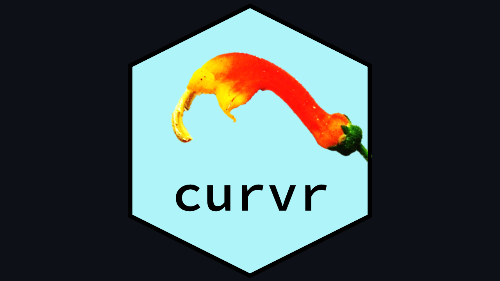
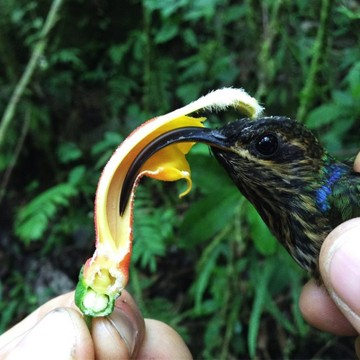
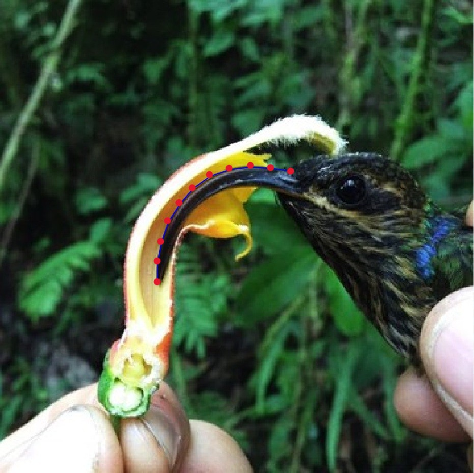
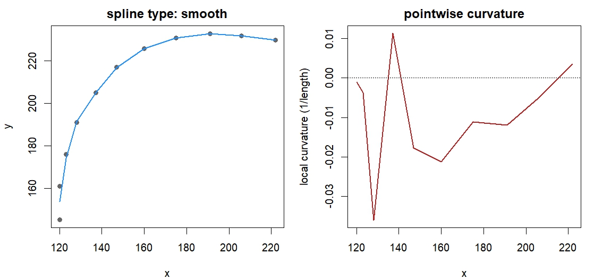

<p align="left">
  
</p>


<br>

### Installation

You can install the development version of `curvr` by:

``` r
# install.packages("devtools")
devtools::install_github("mannfred/curvr")
```
<br>
<br>


### Citation
If you find this package useful, please cite:

```
@article{boehm_2022,
  title={Plant-pollinator specialization: Origin and measurement of curvature},
  author={Boehm, Mannfred M.A. and Jankowski, J.E. and Cronk, Q.C.B.},
  year={2022},
  journal={The American Naturalist},
  volume={199},
  number={2},
  pages={206--222}
}
```

[Click here](https://mannfred.github.io/media/pdfs/Boehm_etal_2022_AmNat.pdf) 
for a .pdf of the paper, where we outline the motivation for this package, 
define "curvature", and offer a case study with *Epimedium* nectar spurs. 

<br>
<br>

### Example

This photograph of *Centropogon granulosus* and Buff-tailed Sicklebill was taken by 
[Julian Heavyside](https://scholar.google.ca/citations?hl=en&user=5oVlLOkAAAAJ&view_op=list_works&sortby=pubdate) in the southeastern Andes of Peru:

<p align="left">
  
</p>

<br>

A common practice in ecology is to measure and compare traits. 
For example, in a comparative study, we might ask "how curved is the bill of this hummingbird?". 
One way to measure bill curvature is to add landmarks along the 
dorsal side of the bill using `geomorph`. 
Given these landmark data, `curvr` can find the best-fit spline, and then calculate 
total curvature from said spline.  


``` r
library(curvr)
library(geomorph)

# landmark the .jpg in this R package's directory
geomorph::digitize2d(filelist="man/figures/Figure_A2.jpg", nlandmarks=11, tpsfile="sicklebill.tps", verbose=F)

```
<br>
Or, landmark in [tpsDig](https://www.sbmorphometrics.org), 
as I've done to create the following figure (landmarks have been enlarged for emphasis):

<p align="left">
  
</p>

Typically, one would need to be more methodical with landmarking. 
E.g. we have not told `digitize2d()` what the scale is
(although curvature is scale invariant, it's still good practice). 

<br>

`curvr` fits a spline to these 11 landmarks (in red) and calculates the curvature of the spline.

```r
# import the .tps file for curve-fitting
tps <- geomorph::readland.tps(system.file("extdata", "sicklebill.tps", package = "curvr"))

# preview structure of the landmark file
tps
, , 1

      [,1] [,2]
 [1,]  222  230
 [2,]  206  232
 [3,]  191  233
 [4,]  175  231
 [5,]  160  226
 [6,]  147  217
 [7,]  137  205
 [8,]  128  191
 [9,]  123  176
[10,]  120  161
[11,]  120  145

# define the x-coordinate range to fit a spline to
x_range <- c(tps[,,1][1,1], tps[,,1][10,1])

# use plot=TRUE to visualize the curve fit
curvr::curvature_spline(tps[,,1], x_range, spar=0.2, plot=TRUE)
```

<p align="left">
  
</p>

<br>

The `spar=` argument controls the smoothing scale, i.e., how local versus 
global the curvature measurement is. For example, it may be desirable to 
smooth over a hook at the tip of a hummingbird bill as hook curvature, 
being scale invariant could contribute significantly to overall bill 
curvature. Setting `spar` close to zero will resemble an interpolating 
spline, while values closer to 1 will penalize sudden bends. 
See `stats::smooth.spline` for more details.

I have found that `spar` values around 0.2 to 0.4 work well for hummingbird bills.
I suggest using `plot=TRUE` to see what works best for your study organism.

In the above figure, the last two landmarks share the same x-coordinate,
so the spline has taken the average y-value as the last point.
I recommend using `Momocs::coo_alignxax` to align your curves
to the x-axis, which ensures that the fitted spline is a single-valued function. 
```
# calculate curvature (curvr gives radians)
ktot <- curvr::curvature_spline(tps[,,1], x_range=x_range, spar=0.2)$Ktot

# convert to degrees
ktot * (180/pi)
# 101.6 degrees
```

We obtain ~101° bill curvature for this Buff-tailed Sicklebill.
This individual was also measured in Figure 1 of [this pollination study](https://onlinelibrary.wiley.com/doi/full/10.1002/ece3.8988).
<br>
<br>

